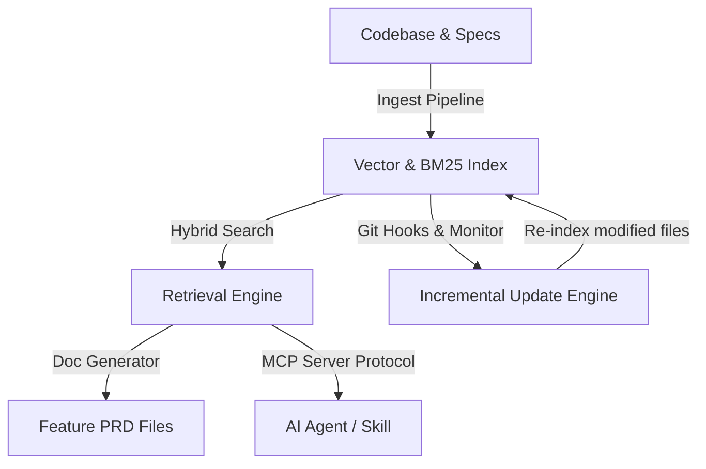

# Master Module Context & Feature PRD Catalog

Welcome to the central documentation index for the **Code-KB / RAG Legado System**.

## System Overview & Architecture

The **RAG Legado System** is an automated repository indexing, retrieval, and PRD documentation generation platform. It extracts context, code structures, AST elements, and markdown specifications from codebases to build a local vector and BM25 hybrid index, serving automated feature PRD generation and LLM query contexts via the Model Context Protocol (MCP).

### Architecture Diagram

---

## Feature PRD Catalog

Below is the complete indexed catalog of individual Product Requirement Documents (PRDs) per system functional domain:

1. **[Indexing Pipeline](indexing-pipeline.md)** (`docs/features/indexing-pipeline.md`)
   - **Scope**: Code parsing, AST symbol extraction, text chunking, and dual vector (SentenceTransformer) / sparse (BM25) index creation.
   - **Key Components**: `rag-legado-skill/mcp_server/ingest`

2. **[Hybrid Search & Retrieval](hybrid-search-retrieval.md)** (`docs/features/hybrid-search-retrieval.md`)
   - **Scope**: Reciprocal Rank Fusion (RRF) combining dense semantic embeddings and sparse keyword matching for precision context retrieval.
   - **Key Components**: `rag-legado-skill/mcp_server/retrieve`

3. **[Doc Generator Engine](doc-generator-engine.md)** (`docs/features/doc-generator-engine.md`)
   - **Scope**: Automated per-feature PRD document generation, section structuring, metadata preservation, and manual section isolation.
   - **Key Components**: `rag-legado-skill/mcp_server/doc_generator.py`

4. **[Incremental Update Engine](incremental-update-engine.md)** (`docs/features/incremental-update-engine.md`)
   - **Scope**: Git-commit tracking, file modification diffing, and selective vector/BM25 re-indexing.
   - **Key Components**: `rag-legado-skill/mcp_server/incremental_update.py`

5. **[MCP Server Protocol](mcp-server-protocol.md)** (`docs/features/mcp-server-protocol.md`)
   - **Scope**: Model Context Protocol (MCP) server endpoints exposing search tools and documentation generation capabilities to AI Agents.
   - **Key Components**: `rag-legado-skill/mcp_server/server.py`

6. **[Bootstrap & Installer](bootstrap-installer.md)** (`docs/features/bootstrap-installer.md`)
   - **Scope**: Environment bootstrapping, dependency isolation (`.venv`), initial indexing setup, and `.ragignore` configuration.
   - **Key Components**: `rag-legado-skill/bootstrap_index.py`, `install.sh`

---

## Verification & Status

- [x] All 6 core feature domains documented in dedicated PRDs.
- [x] All PRD markdown links in `index.md` verified and active.
- [x] Master context updated with architecture workflow and module responsibilities.
